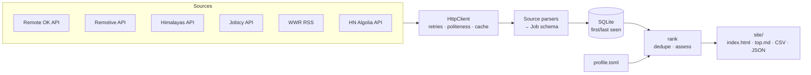

# Remote Radar

Remote Radar pulls remote engineering roles from six public job feeds, normalises them
into one schema, scores every role against a declarative candidate profile, and publishes
the result as a static dashboard that rebuilds itself every morning on GitHub Actions.

A run on 18 November 2026 (UTC+6 profile, resident in Kyrgyzstan, $1,500/month floor):

```
$ uv run radar run --profile me.local.toml --top 3
  Remote OK                         97 jobs
  Remotive                          16 jobs
  Himalayas                        964 jobs
  Jobicy                           229 jobs
  We Work Remotely                 143 jobs
  Hacker News · Who is hiring?     121 jobs

1444 unique roles, 38 match the profile.

 #  SCORE  TRACK           PAY/MO  TYPE       ROLE
 1     91  Python         $12,083  Full-time  Sr. Data Engineer · Carrot
 2     89  Integrations    $3,500  Contract   Full-Stack Developer · Fluence International, Inc.
 3     85  Integrations    $7,000  Full-time  AI Automation Expert (n8n / Make / Zapier / AI Agents) · Kreative…
```

Most of the 1,406 excluded roles are open only to residents of specific countries; the
dashboard keeps them, each with the rule that excluded it.

## Why it exists

Remote job boards overlap heavily, hide "who can apply" in free text, and quote pay in a
dozen formats. Remote Radar makes that part deterministic and auditable:

- **One schema for six sources.** Remote OK, Remotive, Himalayas, Jobicy, We Work Remotely
  and the monthly Hacker News *Who is hiring?* thread.
- **Pay normalised to USD/month.** Ranges like `$80-100k`, `€5,000/month`, `USD 60–80 per
  hour` and structured min/max fields, in 22 currencies. Hourly and daily rates are shown
  as full-time equivalents; converted values are marked approximate.
- **Eligibility rules, not vibes.** Regions ("US only", "EMEA"), explicit country lists and
  accepted UTC offsets are checked against where you can legally work and your timezone.
- **A score you can argue with.** Every role gets a 0–100 score and the list of reasons
  behind it. Excluded roles keep their reason, so filters can be audited instead of trusted.
- **Cross-post de-duplication.** The same role on three boards shows up once, with the
  richest copy kept and the others listed as "also on".

## Quick start

Requires Python 3.11+ and [uv](https://docs.astral.sh/uv/).

```bash
git clone https://github.com/OWNER/remote-radar.git
cd remote-radar
uv sync
uv run radar run --top 15
open site/index.html          # dashboard
```

Other commands:

```bash
uv run radar top -n 20 --track qa_automation     # re-rank from the local database
uv run radar top --json > shortlist.json         # machine-readable output
uv run radar show himalayas:companies/acme/jobs/sdet   # full posting + reasons
uv run radar sources                             # list sources
uv run radar demo --out site-demo                # dashboard from sample data, no network
```

Each run writes `site/index.html` (dashboard), `site/top.md` (digest), `site/jobs.csv`
and `site/jobs.json`. Jobs are stored in `data/radar.db` (SQLite) with first/last-seen
timestamps; only jobs seen in the last 36 hours are ranked, so expired postings drop off.

## Configure your profile

The built-in profile lives in
[`src/remote_radar/profiles/default.toml`](src/remote_radar/profiles/default.toml).
Copy it, edit it, and pass it with `--profile`:

```bash
cp src/remote_radar/profiles/default.toml me.local.toml   # *.local.toml is git-ignored
uv run radar run --profile me.local.toml
```

```toml
[candidate]
utc_offset = 2                 # your timezone
max_timezone_gap = 5           # hours of difference you accept
country = "Georgia"            # where you legally live and work
regions = ["worldwide"]        # add "europe", "apac", ... only if you can be hired there
min_monthly_usd = 2500
engagement_preference = ["contract", "part_time", "full_time"]

[tracks.qa_automation]
label = "QA Automation · Playwright / TypeScript"
title_terms = ["qa", "sdet", "test automation"]
[tracks.qa_automation.keywords]
playwright = 6
cypress = 2
```

Tracks are plain keyword tables with weights. Matches in the title count double; a role
must reach a minimum fit to be considered at all. Unknown keys fail loudly.

## How a role is scored

| Component  | Points | What it measures |
|------------|-------:|------------------|
| Track fit  | 0–40 | Weighted keyword matches against your best track (title ×2) |
| Pay        | 0–20 | 10 at your floor, 20 at 3× your floor; 7 if pay is not stated |
| Location   | 0–20 | Worldwide 20, your region 16, unclear 10, closed 0 |
| Engagement | 0–10 | Ordered by your `engagement_preference` |
| Async      | 0–10 | Async / written-first signals vs. on-call, stand-ups, hybrid |
| Adjustments | ±  | Experience demands above your limit (−15), leadership titles (−10), junior titles (−6), stale postings (−10), fresh postings (+3) |

A role is **eligible** only when it is an engineering role in one of your tracks, pays at
least your floor (or does not say), and is open to your location and timezone.

## Architecture



| Module | Responsibility |
|--------|----------------|
| `sources/` | One module per board; each turns raw payloads into `Job` objects |
| `http.py` | Shared client: per-host rate limit, back-off on 429/5xx, on-disk cache |
| `salary.py` | Pay extraction and normalisation |
| `geo.py` | Region, country and timezone eligibility |
| `scoring.py` | Fit, eligibility, score and reasons; cross-post de-duplication |
| `store.py` | SQLite persistence and fetch log |
| `report.py` | Dashboard, digest and exports |

Adding a board means one new module implementing the `Source` protocol and a line in
`sources/__init__.py`.

## Publish the dashboard with GitHub Pages

`.github/workflows/radar.yml` runs every day at 05:17 UTC (and on demand), restores the
database from the Actions cache, runs the radar and deploys `site/` to GitHub Pages.
Enable it under **Settings → Pages → Source: GitHub Actions**. To use your own profile,
commit it (without anything private) and add `--profile your-profile.toml` to the workflow.

## Data sources and terms

Every source is a public, documented feed. Listings link back to the original posting
and the source is named next to each role, as the providers ask.

| Source | Endpoint | Notes |
|--------|----------|-------|
| [Remote OK](https://remoteok.com) | `remoteok.com/api` | Link back to Remote OK and name it as the source |
| [Remotive](https://remotive.com) | `remotive.com/api/remote-jobs` | Link back, name the source, keep request rates low; do not re-post jobs to other boards |
| [Himalayas](https://himalayas.app) | `himalayas.app/jobs/api/search` | Country and timezone restrictions are structured |
| [Jobicy](https://jobicy.com) | `jobicy.com/api/v2/remote-jobs` | Credit Jobicy and send applicants to the original URL |
| [We Work Remotely](https://weworkremotely.com) | category RSS feeds | Region, country list and job type per item |
| [Hacker News](https://news.ycombinator.com) | `hn.algolia.com/api/v1` | Latest *Who is hiring?* thread, remote posts only |

The HTTP cache (default TTL six hours) keeps repeated local runs from hitting the APIs.

## Development

```bash
uv sync
uv run pytest           # unit tests, no network
uv run ruff check .
uv run ruff format --check .

cd e2e && npm ci && npx playwright install chromium
npm test                # Playwright end-to-end tests against the demo dashboard
```

Unit tests cover salary parsing, location and timezone rules, scoring, every source parser,
the store round-trip, report escaping and the HTTP retry/cache behaviour. CI runs them on
Python 3.11–3.13.

The Playwright suite (TypeScript) builds the dashboard from deterministic sample data
(`radar demo`) and checks it on a desktop and a mobile viewport: default filtering and
ordering, search, track and engagement filters, the audit view of excluded roles, the score
slider, keyboard access, safe external links and the absence of horizontal scrolling.

## Roadmap

- Optional LLM pass for postings whose location or pay is only described in prose
- Daily "new matches" digest by email or Telegram
- Per-source health panel on the dashboard (latency, error rate, volume trend)

## License

[MIT](LICENSE)
